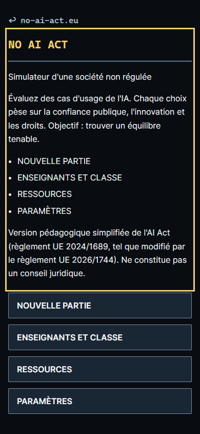
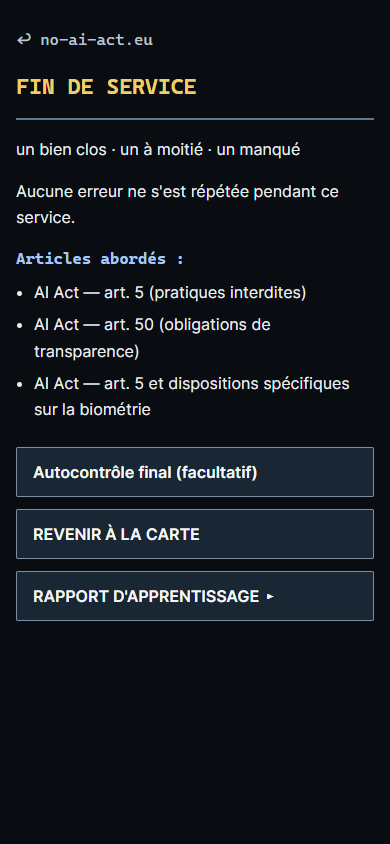
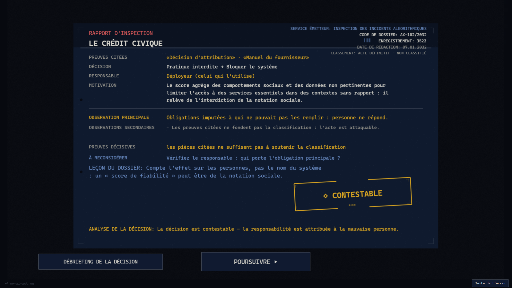

# Evidenze visuali Final QA 4.0

Screenshot locali Chromium, 14 ottobre 2026. Nessuna persona reale o telemetria
di produzione. La cattura non prova da sola leggibilita su dispositivo fisico,
lettura vocale o conformita WCAG. I test JSON dettagliati restano negli output
ignorati; il rapporto principale contiene comandi, esiti e limiti.

| File | Perimetro |
| --- | --- |
| fr-menu-390.png | Build finale, menu compatto FR, testo HTML e comandi direttamente visibili |
| fr-menu-3840.png | Build finale, viewport e canvas 3840x2160, lingua persistita senza query |
| fr-rapport-1920.png | Rapporto desktop FR; ispezione di traduzioni lunghe e gerarchia |
| fr-turno-390.png | Fine Turno realmente raggiunta dopo tre firme, FR |
| it-text-200-390.png | Porzione visibile del testo al 200%; contenuto lungo scorre, non si riduce il font |
| insights-synthetic-390.png | Dashboard privata su dati SINTETICI, non statistiche di giocatori reali |

Gli altri screenshot sono consultabili nei file elencati. Non pubblicare i
contatori sintetici come risultati del gioco; non scambiare uno screenshot
del desktop per una prova di navigazione su telefono.
